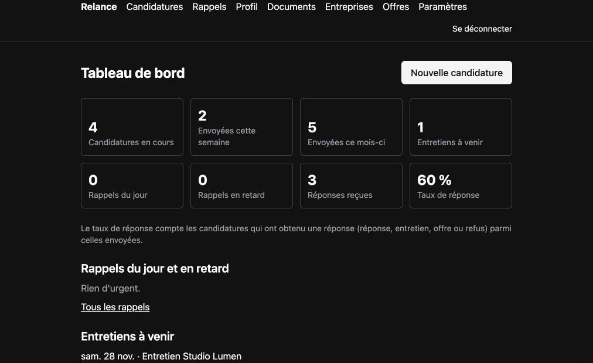

<p align="center">
  
</p>

<h1 align="center">Relance</h1>

<p align="center">
  <strong>Suivre ses candidatures d'alternance et ne jamais oublier une relance.</strong><br>
  Application web installable, en TypeScript sur un seul Worker Cloudflare.
</p>

<p align="center">
  
</p>

<p align="center">
  
  
  
  
  
  
</p>

<p align="center">
  <a href="https://relance.skrim.dev"><strong>Ouvrir Relance</strong></a>
</p>

> L'aperçu montre un compte d'exemple, avec des entreprises inventées.

---

## Sommaire

- [Fonctionnalités](#fonctionnalités)
- [Stack technique](#stack-technique)
- [Architecture](#architecture)
- [Démarrage rapide](#démarrage-rapide)
- [Tests et vérifications](#tests-et-vérifications)
- [Déploiement](#déploiement)
- [Structure du projet](#structure-du-projet)
- [Confidentialité](#confidentialité)

## Fonctionnalités

### 🔑 Connexion sans mot de passe
- Un **lien envoyé par e-mail**, valable 15 minutes et utilisable une seule fois.
- Le lien ouvre une page avec un bouton « Me connecter » : un antivirus de messagerie qui visite le lien ne le consomme pas.
- Demandes de lien limitées par adresse IP et par adresse e-mail.

### 📋 Candidatures
- Création **depuis une offre** (entreprise, poste, source et lien repris) ou en **candidature spontanée**.
- Sept statuts : brouillon, envoyée, réponse reçue, entretien, offre reçue, refusée, abandonnée.
- **Tableau Kanban** avec glisser-déposer à la souris ou au **clavier**, annonces en français pour les lecteurs d'écran, et un menu « Changer de statut ».
- **Liste** triable et filtrable par statut, entreprise et période.
- Contact, canal, CV et lettre utilisés, étiquettes libres, réponses reçues datées, et **historique** automatique des statuts.

### ⏰ Relances et rappels
- Une relance est **proposée une semaine après chaque envoi** (délai réglable).
- Rappels de relance, d'entretien, de date limite ou de tâche, à faire, reporter (+3 jours, +1 semaine, date au choix) ou supprimer.
- Les candidatures **sans réponse depuis trois semaines** sont signalées : relancer ou abandonner, c'est vous qui décidez.
- Un **e-mail récapitulatif à 7 h** (heure de Paris, été comme hiver) le jour des rappels, désactivable.

### 🗂️ Profil, documents, entreprises et offres
- Profil complet (formation, rythme d'alternance, recherche, parcours), avec pour chaque champ le choix de pouvoir le réutiliser.
- **CV en PDF** (5 Mo au plus, vérifiés par leur contenu), conservés tels quels ; un CV utilisé par une candidature n'est jamais effacé, seulement masqué.
- Lettres de motivation et réponses types.
- Entreprises, contacts rattachés et offres saisies à la main, avec leur source et leur statut d'expiration.

### 🔎 Recherche d'offres
- Recherche d'offres d'alternance via l'API officielle **La bonne alternance**, qui inclut les offres de France Travail.
- Les mots-clés sont traduits en métiers du ROME par **ROMEO** (France Travail), affichés avec les résultats.
- Filtres préremplis depuis le profil : métier, ville, distance, date de début.
- **Ajout en un clic** à « Mes offres », avec la source ; l'entreprise est retrouvée ou créée.
- **Doublons repérés** : même identifiant à la source, ou même entreprise, même intitulé et même ville.
- **Recherches enregistrées** avec leurs filtres, relancées en un clic.
- **Ajout depuis un lien** : Relance lit la page de l'offre (données schema.org `JobPosting`, sinon titre et description) et préremplit le formulaire ; une page illisible passe en saisie manuelle. Seules les adresses web publiques sont lues.
- **Offres expirées signalées** : chaque matin, les offres ajoutées sont vérifiées auprès de La bonne alternance (pourvue, annulée, retirée ou date passée).

### ✍️ Brouillons avec l'IA (V2)
- Lettre de motivation, e-mail de relance, e-mail de candidature spontanée et réponses aux questions d'un formulaire, rédigés par **Cloudflare Workers AI** (Mistral Small 3.1). **Jamais de CV.**
- **Accord préalable** après avoir vu exactement les données envoyées : seuls les champs du profil autorisés au partage et la candidature concernée. Accord retirable dans les paramètres.
- Le modèle n'utilise que ces données et écrit « [à compléter] » plutôt que d'inventer. Le texte reste un brouillon modifiable.
- **10 brouillons par jour et par compte** ; quota atteint ou service indisponible : Relance le dit, sans repli vers un service payant.

### 📨 Candidature assistée (V2)
- Depuis une candidature : mode d'envoi, réponses au formulaire, **informations manquantes** signalées.
- **Aperçu obligatoire** avant envoi : entreprise, poste, destinataire, lien, CV, lettre, réponses et coordonnées partagées, avec « Modifier », « Annuler » et « Confirmer l'envoi ».
- Relance n'envoie rien elle-même : **e-mail préparé** dans votre messagerie (CV à joindre) ou **site de l'offre** ouvert pour y postuler.
- À la confirmation, la candidature passe à « Envoyée » et **ce qui a été transmis est conservé**.

### 📊 Tableau de bord et données
- Candidatures en cours, envoyées dans la semaine et le mois, entretiens à venir, rappels, réponses et **taux de réponse**, répartition par statut.
- **Export CSV** des candidatures, prêt pour Excel.
- **Suppression du compte** : données et fichiers effacés définitivement.
- Installable sur le téléphone comme une application.

## Stack technique

| Domaine | Outils |
|---|---|
| Front | React 19, Vite, React Router, TanStack Query, Tailwind CSS, dnd-kit |
| API | Hono sur Cloudflare Workers, validation Zod (schémas partagés avec le front) |
| Données | Cloudflare D1 (SQLite) avec Drizzle ORM et ses migrations, Cloudflare R2 pour les PDF |
| Comptes | Better Auth (lien magique), limitation de débit Cloudflare |
| E-mails | Brevo (connexion et rappels) |
| IA | Cloudflare Workers AI, Mistral Small 3.1 (brouillons, avec accord) |
| Offres | API La bonne alternance, ROMEO (France Travail), geo.api.gouv.fr |
| Tâche planifiée | Cron Trigger Cloudflare, chaque matin |
| Qualité | Vitest dans le runtime Workers, Biome, TypeScript strict, GitHub Actions |

## Architecture

```
Navigateur ou PWA (React)
        │  HTTPS, relance.skrim.dev
        ▼
Un seul Worker Cloudflare
 ├── fichiers du front (React compilé)
 ├── /api/*  API REST (Hono) ──► D1, base SQL en juridiction UE
 │                           ──► R2, fichiers PDF privés en juridiction UE
 └── tâche planifiée du matin ──► Brevo (e-mails de rappel)
```

- **Coût : 0 €.** Tout tient dans l'offre gratuite de Cloudflare et de Brevo.
- L'offre gratuite limite chaque requête à **10 ms de calcul**. C'est pour cela qu'il n'y a pas de mot de passe (le hachage serait trop lent) ; le temps de calcul de chaque requête est mesuré à chaque étape (3 à 9 ms en général).
- Chaque requête est filtrée par le compte connecté : la ressource d'un autre compte répond 404.
- Le détail des choix est dans [`docs/architecture.md`](docs/architecture.md), et le besoin dans [`docs/cahier-des-charges.md`](docs/cahier-des-charges.md).

## Démarrage rapide

**Prérequis :** Node.js 24 ou plus récent et npm.

```bash
git clone https://github.com/sami-krm/Relance.git
cd Relance
npm install
```

Créez un fichier `.dev.vars` à la racine (il n'est jamais commité) :

```bash
BETTER_AUTH_URL=http://localhost:5173
BETTER_AUTH_SECRET=une-longue-chaine-aleatoire
```

Puis créez la base locale et lancez l'app :

```bash
npm run db:migrate:local
npm run dev
```

> Sans clé Brevo en local, le lien de connexion s'affiche dans le terminal au lieu d'être envoyé par e-mail.

## Tests et vérifications

```bash
npm run lint        # Biome
npm run typecheck   # TypeScript (front et Worker)
npm test            # Vitest dans le runtime Workers
```

Les tests couvrent les parcours de l'API : connexion et usage unique du lien, limitation de débit, isolation des comptes, import et suppression des CV, candidatures et historique, relance automatique, e-mail du matin, export CSV et suppression du compte. GitHub Actions les lance à chaque push.

## Déploiement

```bash
npm run db:migrate:remote   # migrations sur la base D1 en ligne
npm run deploy              # build Vite puis déploiement du Worker
```

Les secrets se posent une fois avec `npx wrangler secret put` : `BETTER_AUTH_SECRET`, `BREVO_API_KEY`, `FRANCE_TRAVAIL_CLIENT_ID` et `FRANCE_TRAVAIL_CLIENT_SECRET` (application francetravail.io abonnée à ROMEO v2), et `LBA_API_TOKEN` (clé de production de l'API La bonne alternance). Chaque push sur `main` est déployé par GitHub Actions après les vérifications.

## Structure du projet

```
src/
├── client/        # React : pages, Kanban, formulaires
├── server/        # Hono : routes /api, auth, e-mails, rappels du matin
├── shared/        # schémas Zod et calculs partagés avec le front
└── db/            # schéma Drizzle
migrations/        # migrations SQL générées
tests/             # tests Vitest de l'API
public/            # icônes, manifeste et en-têtes de sécurité
docs/              # cahier des charges, architecture, aperçu
wrangler.jsonc     # Worker, D1, R2, cron, limitation de débit
```

## Confidentialité

- Données et fichiers hébergés dans l'**Union européenne** (juridiction UE de D1 et R2).
- **Aucun traceur** publicitaire ni mesure d'audience, et une politique de sécurité du contenu (CSP) stricte.
- Un seul cookie, nécessaire à la connexion. Les adresses IP ne sont pas enregistrées.
- Les CV ne sont jamais générés ni modifiés : ce sont vos fichiers, servis à vous seul.
- Les détails sont dans la [politique de confidentialité](https://relance.skrim.dev/confidentialite). Contact : hello@skrim.dev.
